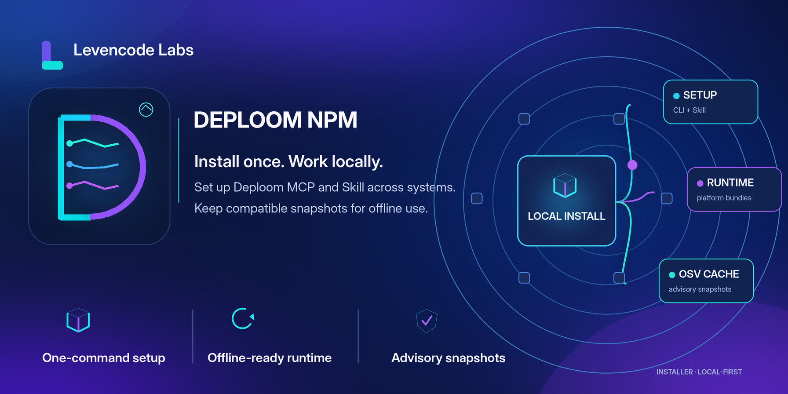

<div align="center">



# Deploom npm

**Install the DepLoom MCP server and upgrade Skill on Windows, Linux, and macOS.**

[Windows setup](#windows-installer) · [Linux and macOS](#linux-and-macos) · [Offline setup](#offline-setup) · [Public data](#public-data) · [Releases](https://github.com/levencode-labs/deploom-npm/releases?q=npm-v) · [Levencode Labs](https://github.com/levencode-labs)

</div>

Use one package with Codex, Claude Code, or OpenCode. It includes the [MCP server and Skill](https://github.com/levencode-labs/deploom-mcp), the pinned [planning engine](https://github.com/levencode-labs/deploom-core), and an embedded Python runtime. The project also publishes a shared index of npm security advisories.

## Windows installer

**Requirements**

Windows x64, Node.js 22 or later with npm, and a supported client. Setup copies the runtime to a versioned directory under `%LOCALAPPDATA%\DepLoom\public`. The installed MCP keeps working after npm clears its download cache.

To install the stable release from npm, run this command in PowerShell. The example configures Codex. Use `claude` for Claude Code or `opencode` for OpenCode.

```powershell
npm.cmd exec --yes --package=@levencode/deploom -- deploom setup codex
```

## Offline setup

Copy the `.tgz` from the [Windows release](https://github.com/levencode-labs/deploom-npm/releases/tag/npm-v0.2.23) to the target machine. Open PowerShell in the directory containing the archive. The same command works with an empty npm cache.

```powershell
npm.cmd exec --offline --yes --package=./levencode-deploom-0.2.23.tgz -- deploom setup codex
```

Restart the client after setup to load the server and discover the Skill.

## Linux and macOS

Use Node.js 22 or newer with npm. The Linux builds target glibc on x64 and ARM64. The macOS build targets Apple Silicon. The native CI runs on Ubuntu 24.04 and macOS 15.

For an online installation, run the following from your project. First setup downloads a private CPython interpreter from GitHub and hash-checked packages from PyPI and the DepLoom MCP release. The installed server runs locally.

```sh
npm exec --yes --package=@levencode/deploom -- deploom setup codex
```

For an offline installation, download the archive matching the destination machine from the [release assets](https://github.com/levencode-labs/deploom-npm/releases/tag/npm-v0.2.23). The available archive prefixes are `deploom-linux-x64`, `deploom-linux-arm64`, and `deploom-darwin-arm64`. For example, on Apple Silicon run the following in the directory containing the file.

```sh
npm exec --offline --yes --package=./deploom-darwin-arm64-0.2.23.tgz -- deploom setup codex
```

Use `claude` or `opencode` in place of `codex` to register another client. Keep running Node.js on its native architecture. Intel macOS, Alpine/musl and Windows ARM64 are outside this release's supported matrix.

## Updates and rollback

To switch back to the previous version retained for that client, run `deploom rollback codex` from an installed CLI. Setup installs the server. To install or refresh the shared public npm advisory snapshot, run `deploom cache refresh`. The client fetches fixed public URLs, verifies the snapshot locally and retains the previous working data if refresh fails. Restart your MCP client after the first refresh so the launcher selects the snapshot. Refresh it again before its seven-day freshness window expires.

Run `deploom cache status` to inspect the local OSV snapshot. This read-only command checks the installed database's size and digest against its local manifest and prints the edition and its UTC expiry. It works offline before client setup and honors `DEPLOOM_MCP_OSV_DIR`. Status is `fresh`, `expiring` during the last 48 hours, `expired`, `missing`, or `invalid`. The last three return exit code 1. For a custom directory, its owner supplies and refreshes the snapshot. The installer's `cache refresh` updates the default shared cache.

### Interpreting vulnerability coverage

For a public npm project, `get_upgrade_plan` works with OSV alone. On a clean installation with external evidence enabled, the planner sends package names and versions to the public OSV API. When the launcher selects a snapshot, the planner checks advisories locally. Resolving package versions can still require registry access. A stale snapshot or an inconclusive lookup produces `UNKNOWN`.

DepLoom 0.2.22 can also use the public npm metadata it already fetched for planning. If an anonymous response directly from `https://registry.npmjs.org` confirms the name and exact version, the planner can report zero known findings when the fresh snapshot has no matching advisory. For example, `clsx@2.1.1` can be assessed even in an edition containing no entries for `clsx`. In this case the row reports `publicIdentitySource: NPM_PUBLIC_PACKUMENT`, and the advisory check makes no additional network request. A registry mirror, a system proxy or metadata for another version cannot establish this identity.

On Windows, run these commands from the directory containing the official release archive, then restart Codex. The second command downloads the shared snapshot and requires internet access.

```powershell
npm.cmd exec --offline --yes --package=./levencode-deploom-0.2.23.tgz -- deploom setup codex
npm.cmd exec --offline --yes --package=./levencode-deploom-0.2.23.tgz -- deploom cache refresh
```

Hosts can still set `DEPLOOM_MCP_PUBLIC_NAMES` to comma-separated exact npm names whose public identity they have independently verified. For mixed projects, declare private scopes such as `@internal` in `DEPLOOM_MCP_PRIVATE_SCOPES`. These scopes take precedence over public identity evidence and are excluded from public metadata and OSV requests.

For corporate fallback from a local snapshot, the host enables `DEPLOOM_MCP_DISABLE_EXTERNAL_EVIDENCE=1` and sets both `DEPLOOM_MCP_REGISTRY_ADVISORY_SOURCE` and `DEPLOOM_MCP_CORPORATE_ADVISORY_SOURCE` to the approved corporate HTTPS registry used by the plan. For private scoped registry dependencies, the host also grants metadata access by setting `DEPLOOM_MCP_ALLOWED_PROJECT_REGISTRY` to that registry. A package omitted from its bulk response has unconfirmed coverage. A direct dependency plan and a full lockfile audit can have different totals. Compare identical exact package–version pairs and use the same counting unit for both sources.

After setting up a CLI version with the coverage diagnostic, run it against the saved Draft result. Keep the original `plan.json` beside `result.json`.

```sh
deploom diagnose-coverage path/to/result.json
```

To replay older rows, pass `--snapshot-dir path/to/osv` explicitly and supply the original host scope and public-name settings. The command checks the snapshot identity against the saved run. Add `--inventory path/to/canonical-yarn-inventory.json` to count identical package–version pairs in the saved Yarn inventory, or `--focus package-name` to show reasons for one dependency. The command runs locally using the installed runtime for that CLI version.

## Release checks

The Windows CI workflow builds a development wheel from the pinned public sources, verifies the CPython archive and every wheel against the lock file, and checks the actual npm tarball. The release workflow pins the official MCP wheel in `ci/mcp-release.json`, tests the packed bytes on Windows, and publishes the same archive to npm using the `latest` tag for stable versions and `next` for prereleases with GitHub OIDC. A second Windows runner checks the npm download and the exact-version install before the GitHub release publishes `upstream.json` and the tarball for downstream import. To run the installation test on Windows with the three clients on PATH, use `ci/test-install.ps1 -Tarball <archive> -Work <new-directory>`.

Semgrep scans the installer and exact Core and MCP revisions. Trivy scans the four unpacked runtimes and checks that it recognized the installed Python and npm package versions. High or critical findings and unreviewed security rules block publication. The source report also lists variable subprocess calls for audit.

## Public data

Run `python cache/build_osv.py build/osv` with Python 3.12 or newer to create an index from the public npm ecosystem export. The output includes the compressed SQLite database and its versioned manifest. Run `python -m unittest discover -s cache` for the synthetic export test.

## Sharing an observation

Reproduce a migration in a public fixture under `fixtures/<name>/check.cjs`. The fixture should install exact public versions and run the stated check. Once it passes on GitHub, use its immutable commit URL as `source` in a pull request against `docs/v1/history.json` or `docs/v1/knowledge.json`. The record identifies the package, old and new version, and the observed check or named recipe. Reviewers can rerun the fixture before merging. Installed clients only read the snapshots. Project lockfiles, dependency inventories and local results stay on the developer's machine.

For automatic intake, submit only additions to the two data files (up to 10 rows and 3 packages). The validator reads regular Git blobs against the schema shipped by MCP, checks both versions on the public npm registry and matches the exact claim against the maintainer-reviewed evidence.json beside the pinned fixture. One reviewed fixture can support several contributions. A pinned local model on an isolated GitHub runner checks semantics. A failed or unavailable audit leaves the PR for review. Changes to fixtures, code or policies require a maintainer. Arbitrary notes and instructions do not belong in a record.

Use `get_shared_migration_evidence` to look up an exact transition after refreshing the cache. A passing result on the example is advisory. Run the checks that matter for the receiving project.

MCP 0.2.23 and later verify the Ed25519 signature over the domain-separated SHA-256 digest of the exact Pages payload at `v1/cache.json`, using `v1/cache.sig` and the public key bundled with the client. The stdio server refreshes in the background on startup and daily. A network, schema or authenticity failure selects the bundled example. The result reports `snapshotSource`. Restricted corporate mode skips this background network request. Key rotation requires distributing the new public key to clients before retiring the previous one.

## License

The installer and first-party data tooling use the [Apache License 2.0](LICENSE). Runtime components retain their upstream licenses. Installation and redistribution of the Windows binaries are offered subject to the [CPython Windows binary conditions](https://github.com/python/cpython/blob/3.13/PC/crtlicense.txt). Distributors and external users must agree to those terms for the Microsoft code delivered with the Python interpreter. The package contains the complete original terms in `runtime/LICENSE.txt` and `THIRD_PARTY_NOTICES/CPython/LICENSE.txt`.

The two Visual C++ runtime files included with CPython are distributed unchanged as part of that interpreter. The Z3 binaries are built from the pinned Z3 source with MinGW-w64. Their source identity, compiler notices and GCC Runtime Library Exception are included under `THIRD_PARTY_NOTICES/z3-solver/`. The Windows integration includes the pywin32 components used by the MCP. The optional Pythonwin GUI and Exchange MAPI extensions are omitted.
